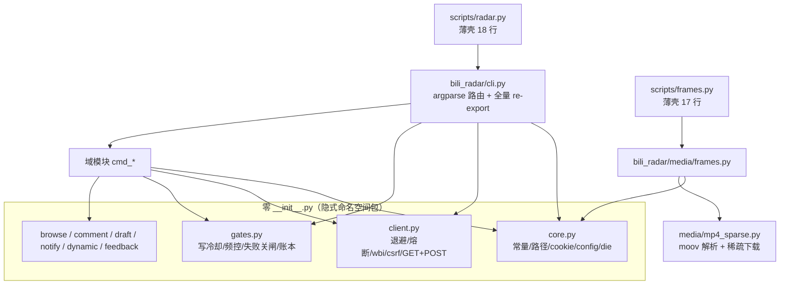

# AGENT.md — interest-radar 代码图谱与索引

> **用途**：给 agent / 开发者用的**定位地图**。要改某个功能，先在这里查到「文件 → 函数 → 行号」，
> 不要全仓 grep。人读的说明书在 [`SKILL.md`](SKILL.md)，判据红线在 [`templates/charter.md`](templates/charter.md)，本文件只讲**代码在哪**。
>
> 快照：2026-10-27（HEAD `c5dd984`）。行号会漂，**改代码请顺手更新本文件**。

---

## 0. 30 秒上手

| 我想… | 去哪 |
|---|---|
| 跑命令 | `python3 scripts/radar.py <子命令>`（入口薄壳 `scripts/radar.py`） |
| 看一条命令怎么实现的 | 第 3 节「命令 → 函数」表 |
| 改一个功能 | 第 4 节「功能 → 代码位置」索引 |
| 改开关/阈值/频控 | 第 5 节「配置键」——注意 **运行态 config 在 `interests/`，不在仓库** |
| 找运行时产生的文件 | 第 6 节「状态文件」 |
| 找 B站接口调用点 | 第 7 节「外部 API」 |
| 改代码前先看规矩 | 第 9 节「约定与坑」 |

**一句话架构**：`radar.py`（薄壳）→ `bili_radar/cli.py`（argparse 路由）→ 各**域模块** `cmd_*` 函数；
所有网络请求走 `client.py`，所有写操作闸走 `gates.py`，基础设施在 `core.py`。

---

## 1. 架构分层



**依赖方向**（硬规矩）：域模块只依赖 `core` / `client` / `gates`，**互相不 import**。
唯一例外：`draft.py` → `comment.post_reply`（复用发评论原语）。

---

## 2. 模块地图

`scripts/` 下（行数为 2026-10-27 快照）：

| 文件 | 行数 | 职责 | 关键符号（起始行） |
|---|---|---|---|
| `radar.py` | 18 | CLI 薄壳：`sys.path` + `from bili_radar.cli import main` | — |
| `frames.py` | 17 | 抽帧薄壳 → `bili_radar.media.frames.main` | — |
| `bili_qr_login.py` | 115 | 扫码登录自救（**唯一用 requests+qrcode 的脚本**，非标准库） | `S` session、`QR_PATH`、主流程脚本体 |
| `apply-cron.py` | 82 | 切 cron 调度模式（all / valley） | `EXPR`、`find_job()`、`main()` |
| `bili_radar/core.py` | 60 | 基建，零依赖 | `UA:14` `API:16` `die:19` `cookie_path:24` `state_dir:29` `load_cookie:42` `read_config:52` `clean:60` |
| `bili_radar/client.py` | 173 | 请求层 | `MIX:19` `_BACKOFF:25` `_retry_sleep:28` `_note_ok:33` `_note_fail:37` `get:43` `wbi_keys:92` `wbi_sign:100` `csrf_from_cookie:106` `post_json:111` `post_form:144` |
| `bili_radar/gates.py` | 144 | 写闸 | `note_failure:15` `write_log:33` `_write_cooldown:46` `_write_gate:73` `_write_fail:95` `_record_write:123` `mention_log:128` `_ago_h:141` |
| `bili_radar/cli.py` | 153 | argparse 路由 + re-export | `main:40`（各 `add_parser` 见 3 节） |
| `bili_radar/browse.py` | 145 | 浏览域 | `cmd_check:15` `cmd_search:31` `fetch_subtitle_text:70` `cmd_sub:94` `cmd_seen:121` |
| `bili_radar/comment.py` | 349 | 评论域（最大） | `post_reply:18` `cmd_reply:37` `cmd_rate:140` `fetch_hot_comments:170` `cmd_comment_check:184` `cmd_comment:234` `anon_get:307` `visible_anon:318` `cmd_check_reply:345` |
| `bili_radar/draft.py` | 184 | 草稿审核状态机 | `drafts_file:19` `load_drafts:23` `save_drafts:38` `cmd_draft:44` |
| `bili_radar/notify.py` | 198 | 通知 / 私信读写 | `cmd_msg:18` `cmd_dm:73` `cmd_notify:135` `radar_unread:198` |
| `bili_radar/dynamic.py` | 77 | 动态发/删 | `cmd_dynamic:15` `cmd_dynamic_del:59` |
| `bili_radar/feedback.py` | 138 | 反馈/统计/活跃度 | `cmd_feedback:12` `cmd_stats:43` `cmd_engagement:65` |
| `bili_radar/media/frames.py` | 365 | 抽帧流程 | `http_get_json:50` `wbi_keys:73` `wbi_sign:83` `video_info:89` `playurl:100` `subtitles:120` `fmt_ts:141` `extract_frame:146` `extract_frame_local:159` `download_video:171` `pick_points:203` `build_grid:216` `main:259` |
| `bili_radar/media/mp4_sparse.py` | 202 | moov 解析 + 稀疏下载 | `_fetch_range:20` `_parse_boxes:28` `_find_box:51` `_table:61` `_SparsePlan:78` `sparse_plan:145` `build_sparse:184` |

> ⚠️ `client.py` 的 docstring 里自称 `bili_client.py`，`cli.py` 顶部 docstring 里还写着旧文件名 `bili_client.py`/`frames.py`——**都是过期注释，别被带偏**。

---

## 3. 命令 → 处理函数 → 模块（CLI 索引）

`scripts/radar.py <cmd>`；登记点在 `bili_radar/cli.py:main()`。

| 子命令 | cli.py 行 | 处理函数 | 实现在 |
|---|---|---|---|
| `check` | 44 | `cmd_check` | `browse.py:15` |
| `search` | 46 | `cmd_search` | `browse.py:31` |
| `sub` | 54 | `cmd_sub` | `browse.py:94` |
| `seen` (check/add) | 59 | `cmd_seen` | `browse.py:121` |
| `reply`（@主号/楼中楼） | 64 | `cmd_reply` | `comment.py:37` |
| `check-reply`（匿名可见性） | 71 | `cmd_check_reply` → `visible_anon` | `comment.py:345` |
| `rate`（看/改频控） | 76 | `cmd_rate` | `comment.py:140` |
| `comment-check`（水军快筛） | 102 | `cmd_comment_check` | `comment.py:184` |
| `comment`（自发评论） | 107 | `cmd_comment` | `comment.py:234` |
| `feedback` | 82 | `cmd_feedback` | `feedback.py:12` |
| `stats` | 140 | `cmd_stats` | `feedback.py:43` |
| `engagement`（活跃度） | 142 | `cmd_engagement` | `feedback.py:65` |
| `draft` (new/list/approve/discard/stats) | 91 | `cmd_draft` | `draft.py:44` |
| `dynamic`（发动态） | 113 | `cmd_dynamic` | `dynamic.py:15` |
| `dynamic-del`（删动态） | 118 | `cmd_dynamic_del` | `dynamic.py:59` |
| `msg`（发私信） | 123 | `cmd_msg` | `notify.py:18` |
| `dm`（读私信） | 129 | `cmd_dm` | `notify.py:73` |
| `notify`（@我/回复我） | 136 | `cmd_notify` | `notify.py:135` |

独立入口（非 radar.py）：`python3 scripts/frames.py --bv ...` → `media/frames.py:main`。

---

## 4. 功能 → 代码位置（改动索引）

| 想改的功能 | 主文件 | 具体符号 |
|---|---|---|
| **请求退避 / 熔断**（指数退避、429、-412 风控、连续 3 次熔断） | `client.py` | `_retry_sleep:28` `_note_fail:37` `get:43` `post_json:111` `post_form:144` |
| **wbi 签名 / csrf 提取** | `client.py` | `MIX:19` `wbi_keys:92` `wbi_sign:100` `csrf_from_cookie:106` |
| **写冷却**（两次写操作最短间隔 `write.cooldown_sec`） | `gates.py` | `_write_cooldown:46` |
| **通用写闸**（enabled + per_hour/per_day 频控） | `gates.py` | `_write_gate:73` |
| **连续失败自动关闸**（3 次 → 关 `write.<kind>.enabled` / `mention.enabled`） | `gates.py` `comment.py` | `_write_fail:95`；`note_failure:15`；调用点 `comment.py:102` `:281`、`dynamic.py:48`、`notify.py:64`、`draft.py:171` |
| **写账本**（`write-log.jsonl` / `mention-log.jsonl`） | `gates.py` | `_record_write:123` `write_log:33` `mention_log:128` `_ago_h:141` |
| **搜索**（wbi search/type，按天数/排序过滤） | `browse.py` | `cmd_search:31` |
| **字幕读取**（`player/wbi/v2` → 字幕 CDN） | `browse.py` | `fetch_subtitle_text:70` |
| **字幕可信度校验**（语速 3~15 字/秒、两次不一致则判不可信） | `browse.py` | `cmd_sub:94` |
| **seen 判重** | `browse.py` | `cmd_seen:121` |
| **@ 主号 / 楼中楼回复** | `comment.py` | `cmd_reply:37` |
| **发评论原语**（POST `/x/v2/reply/add`） | `comment.py` | `post_reply:18`（`draft.py:114` 复用） |
| **自发评论** | `comment.py` | `cmd_comment:234` |
| **评论区水军快筛** | `comment.py` | `fetch_hot_comments:170` `cmd_comment_check:184` |
| **匿名可见性自检**（阿瓦隆） | `comment.py` | `anon_get:307` `visible_anon:318` |
| **陌生人草稿状态机**（pending→approved/discarded/expired/failed） | `draft.py` | `cmd_draft:44` `load_drafts:23` `save_drafts:38` |
| **通知（@我 / 回复我）** | `notify.py` | `cmd_notify:135` `radar_unread:198` |
| **私信读 + 时间水位** | `notify.py` | `cmd_dm:73` |
| **私信发 + 白名单** | `notify.py` | `cmd_msg:18` |
| **动态发 / 删** | `dynamic.py` | `cmd_dynamic:15` `cmd_dynamic_del:59` |
| **反馈权重 / 证据** | `feedback.py` | `cmd_feedback:12` |
| **统计（兴趣线 + 权重 + 已看数）** | `feedback.py` | `cmd_stats:43` |
| **活跃度判读（活跃/沉默/故障）** | `feedback.py` | `cmd_engagement:65` |
| **抽帧九宫格 / 硬字幕长图** | `media/frames.py` | `pick_points:203` `build_grid:216` `main:259` |
| **稀疏下载**（moov 解析、GOP 区间、零填充） | `media/mp4_sparse.py` | `_SparsePlan:78` `sparse_plan:145` `build_sparse:184` |
| **cron 模式切换（all/valley）** | `apply-cron.py` | `EXPR` `find_job()` |
| **cookie 失效自救（扫码）** | `bili_qr_login.py` | 脚本体（`QR_PATH` 输出二维码 → 轮询 → 跟随 crossDomain → 覆写 cookie） |

---

## 5. 配置键 → 读取点 → 作用

⚠️ **运行态 config 在 `state_dir()/config.json`**（= `~/.openclaw/workspace/interests/config.json`），
仓库里的 `templates/config.json` 只是模板；`.gitignore` 已忽略 `config.json`。改完**立即生效**（无缓存）。

| 配置段 | 键 | 读取点 | 作用 |
|---|---|---|---|
| `mention` | `enabled` `name` | `comment.py:47-48` | @ 主号的两道开关闸 |
| `mention` | `mid` | `notify.py:82` | `dm` 默认读谁的会话（主号 mid） |
| `mention` | `per_hour` `per_day` `per_round` `min_score` `template` `forbid` | `comment.py:46-85` `cmd_rate:140` | @ 频控 / 打分门槛 / 正文模板 / 敏感词 |
| `comment_check` | `num` `warn_ratio` `name_keywords` `ai_patterns` | `comment.py:190-194` | 水军快筛参数（`name_keywords` 也被 `draft.py:66` 用来拒水军昵称入稿） |
| `draft` | `enabled` `per_12h` `per_24h` `reply_interval_days` `forbid` | `draft.py:61-148` | 草稿开关 / 频控 / 同人 30 天 / 敏感词 |
| `write.<kind>` | `enabled` `per_hour` `per_day` `forbid` `allow_mid` `same_video_once` | `gates.py:79`；`comment.py:257-268`；`dynamic.py:27`；`notify.py:82` | 写操作闸（kind = `comment`/`dynamic`/`message`） |
| `write` | `cooldown_sec` | `comment.py:98` `:268`、`draft.py:164`、`dynamic.py:41`、`notify.py:51` | 写冷却秒数（默认 120） |
| `budget` | `max_subtitles_per_round` `max_push_per_round` `min_total_score` | **代码不读** | 只在 SKILL/charter 层由模型遵守（2026-10-27 已放开为 0=不限） |
| `schedule` | `mode` `cron` | 由 `apply-cron.py` 写 | 记录，供报告引用 |

---

## 6. 状态文件（运行时，`state_dir()` = `~/.openclaw/workspace/interests/`）

`state_dir()` 靠**向上找 `skills/interest-radar` 目录标记**定位（`core.py:29`），可用环境变量 `INTERESTS_DIR` 覆盖。

| 文件 | 写者 | 作用 |
|---|---|---|
| `profile.md` | 人（模型不许改） | 兴趣线 |
| `charter.md` | 人 | 判据/红线 |
| `config.json` | 人 / `rate` / 失败自动关闸 | 运行配置（见 §5） |
| `weights.json` | `feedback.cmd_feedback` | 主题权重 |
| `evidence.jsonl` | `feedback.cmd_feedback` | 反馈证据 |
| `seen.md` | `browse.cmd_seen`；`comment.cmd_reply` | 判重 + `mentioned` 记录 |
| `out/<YYYY-MM-DD>.md` | 模型 | 每日报告 |
| `mention-log.jsonl` | `comment.cmd_reply` | @ 记录（频控/冷却靠它） |
| `mention-fails.json` | `gates.note_failure` | @ 失败计数（≥3 关闸） |
| `write-log.jsonl` | `gates._record_write` | 所有写操作账本（频控/冷却靠它） |
| `write-fails-<kind>.json` | `gates._write_fail` | 写失败计数（≥3 关闸） |
| `drafts.jsonl` | `draft.load/save_drafts` | 草稿状态机 |
| `dm-state.json` | `notify.cmd_dm` | 私信时间水位 |
| `notify-state.json` | `notify.cmd_notify` | @/回复 时间水位 |
| `frames/frames_<BV>.png` `+.json` | `media/frames.main` | 抽帧产物 |

仓库外：
- cookie：`~/.openclaw/secrets/bilibili-cookies.txt`（路径可由 `BILI_COOKIE_FILE` 覆盖，`core.py:24`）
- 二维码：`workspace/tmp/bili-qr-login-<ts>.png`（`bili_qr_login.py`）

---

## 7. 外部 API（B站）调用点

| 接口 | 调用点 |
|---|---|
| `/x/web-interface/nav`（wbi keys / 登录校验） | `client.py:93`、`browse.py:16`、`notify.py:56` `:97`、`media/frames.py:74` |
| `/x/web-interface/wbi/search/type`（搜索） | `browse.py:35` |
| `/x/web-interface/view`（视频元信息 aid/cid） | `browse.py:96`、`comment.py:90` `:198` `:251`、`draft.py:124`、`media/frames.py:90` |
| `/x/player/wbi/v2`（字幕，**必须签名**） | `browse.py:83`、`media/frames.py:120` |
| `/x/player/wbi/playurl`（抽帧直链） | `media/frames.py:103` |
| `/x/v2/reply/add`（发评论/@/回复） | `comment.py:18`（`post_reply`）、`comment.py:271`（自发） |
| `/x/v2/reply?sort=2`（热评） | `comment.py:172` |
| `/x/v2/reply/wbi/main`（匿名读评论，验证可见性） | `comment.py:333` |
| `/x/msgfeed/at` `/x/msgfeed/reply` `/x/msgfeed/unread` | `notify.py:169-177` `:198` |
| `/x/dynamic/feed/create/dyn`（发动态，**只吃 JSON body**） | `dynamic.py:60` |
| `dynamic_svr/rm_dynamic`（删动态） | `dynamic.py:73` |
| `api.vc.bilibili.com/web_im/v1/web_im/send_msg`（发私信） | `notify.py:64` |
| `api.vc.bilibili.com/svr_sync/v1/svr_sync/fetch_session_msgs`（读私信） | `notify.py:88` |

---

## 8. 测试地图

零第三方依赖，纯 `unittest` + mock，**不碰真实账号/网络/凭据**：

```bash
cd <skill>/scripts && python3 -m unittest discover tests -v
```

| 文件 | 覆盖 | 用例 |
|---|---|---|
| `test_backoff.py` | 退避/熔断 | `test_retry_sleep_exponential` `..._cap_60` `test_fuse_dies_after_3` `test_note_ok_resets_streak` `test_fuse_not_triggered_below_3` `test_get_business_code_no_retry` |
| `test_core.py` | `state_dir` 路径（包化后不能算成 `skills/interests`） | `test_default_points_to_workspace_interests` `test_env_override` |
| `test_dm.py` | dm 水位（自己消息不推水位） | `TestDmWatermark` 下 5 例 |
| `test_draft.py` | 草稿状态机 | 入稿校验 / 同人 30 天 / 水军昵称拒 / 24h 过期 / 审批 / 失败计数 |
| `test_engagement.py` | 活跃度三分支 + 窗口 | 5 例 |
| `test_frames_plan.py` | `_SparsePlan` sample→offset 映射（stts/stsc 坑） | 5 例 |
| `test_write_cooldown.py` | 写冷却（两账本取最新） | 5 例 |

**规矩**：改核心闸逻辑（draft/engagement/冷却/退避）**必须跑一遍全绿**；新功能补测试。

---

## 9. 约定与坑（改代码前必读）

1. **零 `__init__.py`**：`bili_radar/` 是隐式命名空间包，**目录即领域**。新功能往对应域模块加，**禁止再长大文件**。
2. **域模块互不 import**（只依赖 `core`/`client`/`gates`）。唯一例外 `draft → comment.post_reply`。
3. **外部调用只走 CLI**：`python3 scripts/radar.py <cmd>`，**不要直接 `import bili_radar.*`** 当库用。
4. **写操作默认干跑**：所有写命令（reply/comment/dynamic/msg/draft approve）**默认 dry-run**，真发要 `--yes`；干跑不触发写冷却。
5. **闸写在代码里，不靠提示词**：新增写能力必须过 `_write_gate` + 敏感词 fail-closed + 频控 + `--yes`。
6. **删动态不冷却**（`_write_gate(..., rate=False)`，纠错优先）。
7. **字幕必须 wbi 签名**（`player/wbi/v2`）：旧接口 `x/player/v2` 会返回**别的视频的字幕**（2026-10-15 事故）。`cmd_sub` 另有语速合理性校验兜底。
8. **`media/frames.py` 自带一份请求/wbi 代码**（`http_get_json`/`wbi_keys`/`wbi_sign`），**不从 `client.py` 走** —— 因为抽帧是独立入口。改请求层退避时**两处都要看**。
9. **抽帧在线拉流会崩**：沙箱 ffmpeg 拉 CDN 流段错误 → 自动降级**稀疏下载**（`mp4_sparse`），非 faststart 才回退整片下载。这是 `frames.py:314`（`sparse_plan`）→ `:318`（回退 `download_video`）的分支逻辑。
10. **`bili_qr_login.py` 是异类**：用 `requests` + `qrcode`（非纯标准库），是 cookie 失效时的免手动导出兜底。
11. **`state_dir()` 定位法**：向上找 `skills/interest-radar` 标记目录，别依赖 `parents[N]` 层级深度（包化后已踩过一次坑）。
12. **判重/权重/阈值是算术（脚本做），打分是判断（模型做）** —— 别把判断塞进脚本。
13. 改完代码**顺手更新本文件行号**；提交带版本号（仓库有 bump 规矩的话）。

---

## 10. 常用改动 Playbook

| 任务 | 步骤 |
|---|---|
| **加一个子命令** | ① 对应域模块写 `cmd_xxx(a)` ② `cli.py:main()` 里 `add_parser` + `set_defaults(fn=cmd_xxx)` ③ 若是一类新写操作 → 走 `_write_gate` ④ 补测试 ⑤ 更新本文件 §3/§4 |
| **调频控** | 改 `interests/config.json` 对应段（`mention` / `write.<kind>` / `draft`），或 `radar.py rate --per-hour N`（仅 mention）；不用改代码、不用重启 |
| **加一个写操作类型** | 在 `config.json.write` 增 `<kind>` 段 + 代码里 `_write_gate("<kind>")` + `_write_fail(d,"<kind>")` |
| **改请求退避策略** | `client.py:_retry_sleep` / `_note_fail` / `get`；**同步检查 `media/frames.py:http_get_json`** |
| **改抽帧排版** | `media/frames.py:build_grid` `pick_points` |
| **新增兴趣来源渠道** | 目前只有 B站；`charter.md` 平台口径 + 新增域模块（建议独立域，别塞 browse） |